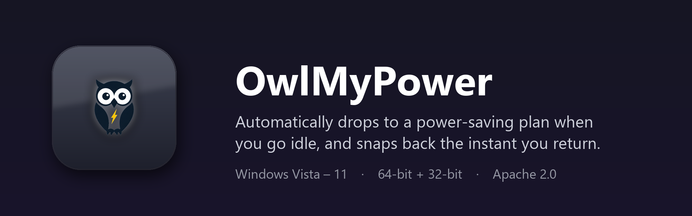

# 🦉 OwlMyPower

Automatic Windows power-plan switcher. It watches system-wide input activity
(keyboard **and** mouse) and switches between an **active** plan and an **idle**
plan, with awareness of AC/battery, fullscreen apps, CPU load, and per-app rules.

| Awake | Asleep |
|:---:|:---:|
|  |  |

Supports **Windows Vista through 11** from a single source, shipped as **two editions**:

| Edition | Target | Python | Look |
|---|---|---|---|
| **Modern** | Windows 8.1 / 10 / 11 | 3.11 (64-bit) | follows OS light/dark |
| **Legacy** | Windows Vista / 7 | 3.8 (32-bit) | native Aero Glass |

## Download & install

Grab the latest from **[Releases](https://github.com/RoundDarkMatter/OwlMyPower/releases)**:

- `OwlMyPower-1.0-Setup.exe` — installer for Windows 10 / 11 (64-bit)
- `OwlMyPower-1.0-Legacy-Setup.exe` — installer for Windows Vista & 7 (32-bit)

## Features

- **Real idle detection** via `GetLastInputInfo` — counts keyboard, mouse, touch.
  Typing or reading never counts as idle.
- **Locale-independent** — power plans are matched by GUID, so it works on any
  Windows display language.
- **AC / battery aware** — optionally never downswitch on AC, and force the saver
  plan below a battery % threshold.
- **Keep-awake guards** — stay on the active plan during fullscreen video/games
  or while the CPU is busy (long compiles, renders, downloads).
- **Per-app rules** — force a chosen plan while named processes are running.
- **Pause** — from the window or the tray (including timed 30 min / 1 hour).
- **Animated owl** — bobs and blinks in the window while you work, sleeps with a
  drifting *Z z Z* when idle; the tray icon blinks and dozes right along with it.
- Restore original plan on exit, start with Windows, start minimized,
  switch notifications, optional logging, single-instance guard, DPI aware.

## Run from source

```powershell
pip install -r requirements.txt
python power_plan_auto_switcher.py
```

Flags:

- `--selftest` — headless check of the Win32 layer (plans, idle time, power/CPU
  status, process count).
- `--min` — start minimized to the tray.
- Set `OWL_FORCE_LEGACY=1` to preview the Legacy UI path on a modern OS.

## Build

**Modern (Windows 10–11)** — 64-bit Python 3.11:

```powershell
pip install pyinstaller -r requirements.txt
python -m PyInstaller OwlMyPower_1.0.spec --noconfirm --clean
# -> dist\OwlMyPower_1.0.exe
```

**Legacy (Windows Vista / 7)** — 32-bit Python 3.8:

```powershell
py -3.8-32 -m pip install pyinstaller -r requirements-legacy.txt
py -3.8-32 -m PyInstaller OwlMyPower_1.0_Legacy.spec --noconfirm --clean
# -> dist\OwlMyPower_1.0_Legacy.exe
```

**Installers** — [Inno Setup 6](https://jrsoftware.org/isinfo.php):

```powershell
ISCC.exe installer\OwlMyPower-Modern.iss
ISCC.exe installer\OwlMyPower-Legacy.iss
# -> installer\output\OwlMyPower-1.0-Setup.exe / OwlMyPower-1.0-Legacy-Setup.exe
```

> PyInstaller cannot cross-compile: each binary must be produced on (or for)
> its own toolchain. The Legacy build uses PyInstaller 5.13.x, whose bootloader
> supports Vista/7, and excludes the modern theme dependencies entirely.

## Settings & logs

Stored next to the executable as `owlmypower_settings.json` (plus
`owlmypower.log` when logging is enabled); falls back to
`%LOCALAPPDATA%\OwlMyPower` if that location is not writable. Writes are
atomic. Fresh installs start with clean defaults — no configuration ships
with the app.

## License

[Apache License 2.0](LICENSE) — © 2026 RoundDarkMatter
